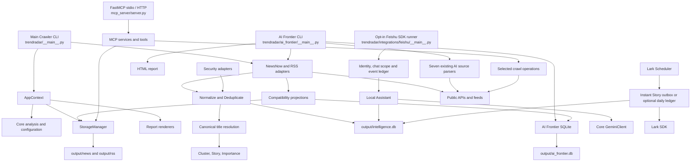

# TrendRadarpoi Code Review

## Current Architecture

TrendRadarpoi is a modular monolith with four independently orchestrated runtime surfaces:
the main crawler, AI Frontier, MCP, and the opt-in Feishu Assistant.

The main crawler and AI Frontier are batch processes. MCP is an interface over history, analysis,
configuration, storage synchronization, and selected crawl operations. SQLite is the persistent
system of record; generated HTML and notifications are delivery products. Feishu is a separate
long-running transport with bounded workers, reconnect cooldown and replies. The Scheduler
owns instant Story delivery and optional daily delivery; collectors do not send notifications.

## Dependency Overview

| Layer | Primary modules | May depend on |
|-------|-----------------|---------------|
| Entry points | Main crawler, AI Frontier, MCP, Feishu runner | Application, domain, and integration services |
| Acquisition | `trendradar/crawler/`, `trendradar/ai_frontier/sources/`, `trendradar/sources/` | HTTP/feed libraries and source DTOs |
| Core/domain | `trendradar/core/`, `trendradar/intelligence/`, `trendradar/storage/base.py` | Standard library and stable shared services |
| Persistence/output | `trendradar/storage/`, `trendradar/report/`, Lark delivery | Domain records and SDK provider |
| Interfaces | `mcp_server/`, `trendradar/integrations/feishu/` | Core/application services, never the reverse |

The intended dependency direction is interface to core. Phase 4 removed the former translation
backflow: `trendradar/ai/` now owns Gemini, translation, analysis, Assistant, Session, retrieval,
and static local tools; the MCP translation facade imports inward from that package.

Persistence currently has three compatible contracts:

- Core hot-list and RSS data use date-partitioned databases at
  `output/news/YYYY-MM-DD.db` and `output/rss/YYYY-MM-DD.db`.
- AI Frontier uses one long-lived `output/ai_frontier.db`, with `(source, url)` uniqueness.
- Canonical items, observations, source runs, clusters, Stories, memberships, Assistant sessions,
  messages, and Lark event/delivery ledgers use local `output/intelligence.db` schema version 7.

Canonical title translation precedes Story publication for main and AI Frontier collection.
Pending items are excluded from Story context; display metadata does not replace raw evidence
or ranking input. Saved delivery payloads remain immutable. See the
[translation contract](intelligence.md#title-translation-before-publication).

Unified ingestion writes remain best effort, not a replacement for existing readers. The Assistant
and Feishu ledgers require the unified database for their own durable state.
Adapters project records back to `NewsData`, `RSSData`, and `AIItem`; setting
`INTELLIGENCE_ENABLED=false` restores legacy acquisition. See
[Unified Intelligence Data Layer](intelligence.md) for the exact contract.

## High Coupling Areas

| Area | Coupling and risk | Safe boundary |
|------|-------------------|---------------|
| `trendradar/__main__.py` | Orders fetch, translation, storage, analysis, reporting, and notification; stage ordering controls incremental behavior | Keep it as a composition root and extract one tested stage at a time |
| `trendradar/storage/local.py` | Owns two schemas, date partitioning, history, push records, snapshots, and compatibility reads | Add migrations/read adapters before changing keys or paths |
| `trendradar/report/` and Lark delivery | Report rendering and saved native-post payloads have distinct contracts | Preserve escaping, chunk boundaries and immutable retry snapshots |
| `trendradar/ai_frontier/` | Still owns subsystem freshness, SQLite state, rendering, and push policy alongside the canonical path | Continue moving shared stages behind tested compatibility projections |
| `trendradar/ai/` | Session, retrieval, citation, tool, and provider limits form one security-sensitive boundary | Keep transports thin and require all tools to pass the static registry |
| `trendradar/integrations/feishu/` | Pinned SDK hooks, authorization, event leases, duplicate suppression, saved-reply delivery retry and daily checkpoints | Revalidate SDK upgrades; test crash recovery without claiming external exactly-once delivery |
| Relative configuration paths | Several modules assume the process starts at the repository root | Centralize path and environment resolution without changing defaults |

The three legacy records (`NewsItem`, `RSSItem`, and `AIItem`) now round-trip through `ContentItem`.
They remain deliberate output contracts until reports, notifications, MCP, and historical readers
are migrated and characterized.

## Refactoring Recommendations

1. **Phase 0 (complete):** entrypoint, configuration, and SQLite behavior are characterized behind
   one settings boundary.
2. **Phase 1 (complete):** `ContentItem`, Source Adapter, Normalize, Deduplicate, unified storage,
   rollback, and explicit backfill run alongside existing outputs.
3. **Phase 2 (complete):** deliver Cluster, stable `Story`, Ranking, explainable Importance, and the
   additive Story report. Story is the primary report unit, not a deferred enhancement.
4. **Phase 3 (complete):** CISA KEV, NVD, and security RSS reuse the canonical and Story pipeline
   with actionable ranking, freshness, and an additive Security report.
5. **Phase 4 (complete):** Gemini is core-owned; bounded local retrieval, principal-scoped sessions,
   immutable citations, and registered Assistant tools are implemented.
6. **Phase 5 (complete offline):** opt-in official SDK transport, configurable identity allowlists,
   private/group mentions, text/images, durable event deduplication, saved-reply delivery retry,
   cooldown, and `Asia/Shanghai` Story delivery.
   Confirmed Windows tenant behavior and remaining live gaps are recorded in
   [Phase 5 UAT](../.planning/phases/05-feishu-assistant/05-LIVE-UAT.md).
7. **Phase 6 (complete offline):** Agent-Reach is exposed only through the named,
   validated [ResearchGateway](research.md); general shell access remains prohibited.
8. **Phase 7 (in progress):** services, health, backup, recovery and CI release tooling
   exist; the [current handoff](phase7-release-20261023/HANDOFF.md) distinguishes
   recorded deployment from local translation repair and remaining acceptance.
9. **Phase 8:** close unit, integration, compatibility, security, and release-verification gaps.

Do not introduce PostgreSQL, a vector database, Kubernetes, microservices, or a complex queue in
this milestone. The current single-user, small-VPS target favors bounded concurrency, short SQLite
transactions, and explicit failure isolation.
